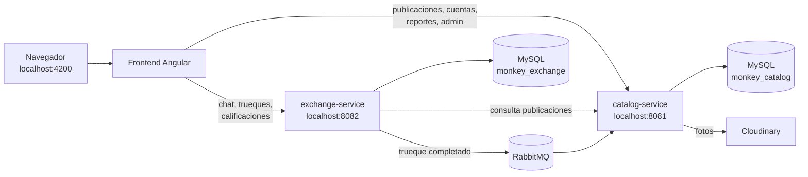

# MonkeyTrueque

MonkeyTrueque es una web para **intercambiar, vender o regalar** objetos y servicios entre personas de Lima. Publicas lo que ya no usas, otras personas te escriben por el chat, acuerdan un punto de encuentro y, cuando ambos confirman la entrega, se califican.

Esta guía está pensada para alguien que nunca ha visto el proyecto: primero explica qué hace la web, luego cómo está armada y al final cómo levantarla en tu computadora paso a paso.

> 📘 **Guía completa del equipo:** abre [`docs/guia/index.html`](docs/guia/index.html) en el navegador. Explica carpeta por carpeta, con y sin código, e incluye diagramas, la base de datos, Flyway, la seguridad, RabbitMQ y preguntas para la presentación.

---

## 1. Qué puedes hacer en la web

### Como visitante (sin cuenta)
- **Inicio y Explorar**: ver publicaciones, buscar por nombre y filtrar por distrito, categoría y modalidad.
- **Ficha de producto**: fotos con zoom, descripción, estado, distrito y la reputación de quien publica.
- **Perfil público** de cada persona, con sus calificaciones.
- **Cómo funciona**: guía de uso y consejos para encontrarse de forma segura.

### Con una cuenta
- **Publicar** un artículo o servicio con 1 a 3 fotos, eligiendo una modalidad:
  - **Trueque**: indicas qué tipo de cosa aceptarías a cambio.
  - **Venta**: pones un precio en soles.
  - **Regalo**: lo das sin pedir nada.
- **Mensajes**: chatear con quien publicó y seguir el trueque paso a paso:
  1. Propuesta → 2. Acuerdo de encuentro (lugar, fecha y hora) → 3. Ambos confirman la entrega → 4. Ambos se califican (1 a 5 estrellas).
  Cuando el trueque se completa, la publicación se cierra sola.
- **Favoritos**: guardar publicaciones que te interesan.
- **Mi cuenta y Configuración**: editar nombre, foto, descripción, distrito y comunidades.
- **Seguridad**: reportar publicaciones, usuarios o mensajes (con capturas como prueba) y bloquear a una persona.
- **Medidas de mi cuenta**: si el equipo te sanciona, ves el motivo y puedes **apelar**.

### Como moderador o administrador (`/admin`)
- Revisar **reportes**: asignarlos, darles prioridad, dejar notas internas y responder a quien reportó.
- **Ocultar o mostrar publicaciones** y **reseñas**.
- **Sancionar** cuentas (sin publicar, sin mensajes o todo) y resolver **apelaciones**.
- Gestionar el **equipo** (dar o quitar rol de moderador o administrador) y **desactivar cuentas** (solo administradores).
- Ver la **actividad** del equipo y una **analítica** de visitas de los últimos 30 días.

---

## 2. Cómo está armado

El proyecto tiene tres partes que corren al mismo tiempo, cada una en su propia terminal:



| Parte | Carpeta | Puerto | Qué hace |
| --- | --- | --- | --- |
| Frontend | `frontend/` | 4200 | La web que ves. Angular 19, Angular Material, NgRx y SCSS. |
| catalog-service | `backend/catalog-service/` | 8081 | Cuentas e inicio de sesión, publicaciones, fotos, perfiles, reportes, sanciones, apelaciones y panel de administración. |
| exchange-service | `backend/exchange-service/` | 8082 | Conversaciones, propuestas de trueque, encuentros, confirmaciones, calificaciones y bloqueos. |

Otras piezas:
- **MySQL**: cada servicio tiene su propia base (`monkey_catalog` y `monkey_exchange`). Las tablas se crean solas al arrancar gracias a **Flyway** (carpeta `src/main/resources/db/migration`).
- **RabbitMQ**: cuando las dos personas confirman un trueque, `exchange-service` envía un aviso y `catalog-service` cierra la publicación. Si RabbitMQ está caído, el aviso se reintenta después.
- **Cloudinary**: servicio en la nube donde se guardan las fotos. En MySQL solo queda el enlace.
- **Inicio de sesión**: usuario y contraseña propios (no Google ni redes sociales). Las contraseñas se guardan cifradas con BCrypt, y al entrar el backend firma un token **JWT** que sirve para los dos servicios. El rol (usuario, moderador o administrador) se consulta en la base en cada petición.
  - El token viaja en una **cookie `HttpOnly`** (`mt_session`, `SameSite=Strict`): el JavaScript de la página no puede leerlo, así que un script malicioso no puede robar la sesión. Los cambios hechos con esa cookie solo se aceptan si vienen de la web de MonkeyTrueque (encabezado `Origin`).
  - La sesión **vence a los 60 minutos** (se cambia con `APP_JWT_EXPIRATION_MINUTES` en `backend/.env`). Al vencer, la web vuelve al inicio de sesión con el aviso *"Tu sesión ha expirado"*. Para mostrarlo en una demo, pon `APP_JWT_EXPIRATION_MINUTES=1` y reinicia el catálogo.
  - Cuando un dato no es válido, el backend responde con el mensaje en español de cada campo (por ejemplo, *"La contraseña debe tener entre 8 y 100 caracteres"*) y la web lo muestra.

Tecnologías del backend: Java 21, Spring Boot, Spring Security, JPA, Flyway, OpenFeign, Spring AMQP y Actuator.

### Estructura de carpetas

```
MonkeyTrueque/
├── Iniciar-MySQL.sql          ← crea las bases y el usuario de MySQL (se ejecuta una vez)
├── backend/
│   ├── .env                   ← configuración local compartida (no se publica)
│   ├── README.md              ← detalle técnico del backend y lista de endpoints
│   ├── DEMO_PRESENTACION.md   ← cómo cargar datos de ejemplo
│   ├── catalog-service/
│   │   ├── .env               ← claves de Cloudinary (no se publica)
│   │   ├── iniciar.cmd        ← arranca este servicio
│   │   └── src/main/java/...  ← controladores, entidades y seguridad
│   └── exchange-service/
│       ├── iniciar.cmd
│       └── src/main/java/...
└── frontend/
    ├── src/app/core/          ← servicios que llaman a la API, sesión y modelos
    ├── src/app/features/      ← páginas: marketplace, cuenta, mensajes, admin…
    └── src/styles/            ← estilos globales
```

---

## 3. Cómo levantar el proyecto en tu computadora

Las instrucciones son para **Windows**, porque los scripts de arranque son `.cmd`.

### Paso 0: instalar los programas (solo la primera vez)

| Programa | Versión | Dónde conseguirlo |
| --- | --- | --- |
| Git | cualquiera reciente | https://git-scm.com |
| Java (JDK) | **21** | https://adoptium.net (elige "Temurin 21 LTS") |
| Node.js | **20 o 22 (LTS)** | https://nodejs.org |
| MySQL Server y MySQL Workbench | **8.x** | https://dev.mysql.com/downloads/installer/ |
| Erlang (lo necesita RabbitMQ) | la que pida RabbitMQ | https://www.erlang.org/downloads |
| RabbitMQ | **4.x** | https://www.rabbitmq.com/docs/install-windows |

No hace falta instalar Maven: cada servicio trae su propio Maven (`mvnw`), que se descarga solo la primera vez.

Para comprobar que quedaron instalados, abre una terminal (`cmd`) y escribe:

```
java -version
node -v
npm -v
git --version
```

Para MySQL y RabbitMQ: abre **Servicios de Windows** (tecla Windows → escribe "Servicios") y verifica que `MySQL80` y `RabbitMQ` estén **En ejecución**.

### Paso 1: descargar el proyecto

```
cd %USERPROFILE%\Downloads
git clone https://github.com/samxcdn/MonkeyTrueque.git
cd MonkeyTrueque
```

### Paso 2: preparar MySQL (solo la primera vez)

1. Abre **MySQL Workbench** y conéctate con tu usuario administrador (normalmente `root`).
2. Menú **File → Open SQL Script…** y abre `Iniciar-MySQL.sql`, que está en la carpeta principal del proyecto.
3. Ejecútalo con el botón del rayo ⚡.

Esto crea las bases `monkey_catalog` y `monkey_exchange` y el usuario `monkeytrueque` que usan los servicios. Las tablas no las creas tú: aparecen solas al arrancar el backend.

### Paso 3: revisar los archivos de configuración

Los servicios leen datos privados de dos archivos `.env`:

- `backend/catalog-service/.env`: claves de Cloudinary. **Sin este archivo la web funciona, pero no se pueden subir fotos**, así que tampoco se puede publicar.
- `backend/.env`: configuración común de los dos servicios.

Si al clonar no aparecen, **pídeselos al equipo por privado** y colócalos en esas rutas. Nunca los subas a GitHub ni los pegues en un chat público.

### Paso 4: arrancar todo (cada vez que quieras usar la web)

**Atajo:** haz doble clic en `iniciar-todo.cmd`, en la carpeta raíz del proyecto. Abre las tres ventanas de abajo de una sola vez. Si prefieres hacerlo a mano, sigue estos pasos.

Abre **tres terminales** y déjalas abiertas. El orden importa: MySQL y RabbitMQ ya deben estar en ejecución.

**Terminal 1: catálogo**
```
cd %USERPROFILE%\Downloads\MonkeyTrueque\backend\catalog-service
iniciar.cmd
```
La primera vez tarda varios minutos porque descarga dependencias. Está listo cuando aparece una línea como `Started CatalogServiceApplication`.

**Terminal 2: intercambios**
```
cd %USERPROFILE%\Downloads\MonkeyTrueque\backend\exchange-service
iniciar.cmd
```
Espera a ver `Started ExchangeServiceApplication`.

**Terminal 3: la web**
```
cd %USERPROFILE%\Downloads\MonkeyTrueque\frontend
npm install
npm start
```
`npm install` solo se necesita la primera vez (o cuando cambien las dependencias). Cuando veas `Local: http://localhost:4200/`, abre esa dirección en el navegador.

> En PowerShell se escribe `.\iniciar.cmd` en lugar de `iniciar.cmd`.

### Paso 5: comprobar que funciona

- http://localhost:8081/actuator/health debe mostrar `{"status":"UP"}`.
- http://localhost:8082/actuator/health debe mostrar `{"status":"UP"}`.
- http://localhost:4200 muestra la web.

### Paso 6: entrar a la web

- **Cuenta normal**: entra a **Iniciar sesión → Crear cuenta** y regístrate con tu propio usuario.
- **Cuenta de administrador**: la primera vez que se arranca el catálogo con la base vacía, se crea la cuenta **`admin`** con contraseña **`Admin123*`**. Registrarse desde la página siempre crea una cuenta normal: los roles de moderador o administrador solo los asigna un administrador desde el panel.
- **Datos de ejemplo** (opcional): en `backend/DEMO_PRESENTACION.md` se explica cómo cargar publicaciones, un reporte y una conversación de prueba.

### Para apagar

En cada terminal, presiona `Ctrl + C` (y responde `S` si te lo pregunta).

---

## 4. Problemas comunes

| Lo que ves | Qué significa | Cómo arreglarlo |
| --- | --- | --- |
| `Communications link failure` al arrancar un servicio | MySQL no está en ejecución | Inicia el servicio `MySQL80` en Servicios de Windows. |
| `Access denied for user 'monkeytrueque'` | No se ejecutó el script de MySQL | Repite el **Paso 2**. |
| `Connection refused` con el puerto 5672 en la consola | RabbitMQ no está en ejecución | Inicia el servicio `RabbitMQ`. Revisa que Erlang esté instalado. |
| `Port 8081 (o 8082) was already in use` | Ese servicio ya estaba abierto en otra terminal | Cierra la otra terminal o usa la que ya está corriendo. |
| `'java' no se reconoce como un comando…` | Java no está instalado o no está en el PATH | Reinstala Temurin 21 marcando la opción "Set JAVA_HOME / Add to PATH". |
| La web dice **"No se pudo conectar con el servidor"** | Uno de los servicios no está encendido | Revisa las terminales 1 y 2 y el **Paso 5**. |
| Al publicar: **"Configura Cloudinary…"** | Falta `backend/catalog-service/.env` | Mira el **Paso 3**. |
| Se cerró tu sesión sola | Abriste la web antes de que el backend terminara de arrancar | Espera a que los dos servicios estén listos y vuelve a iniciar sesión. |

---

## 5. Comandos útiles

| Dónde | Comando | Para qué |
| --- | --- | --- |
| `frontend/` | `npm run build` | Compila la web para producción (queda en `frontend/dist`). |
| `frontend/` | `npm test -- --watch=false --browsers=ChromeHeadless` | Ejecuta las pruebas del frontend (necesita Chrome). |
| `backend/catalog-service/` o `backend/exchange-service/` | `mvnw.cmd test` | Ejecuta las pruebas del servicio. |

Para conocer el detalle técnico (lista de endpoints, colas de RabbitMQ, variables de entorno), mira [`backend/README.md`](backend/README.md).
